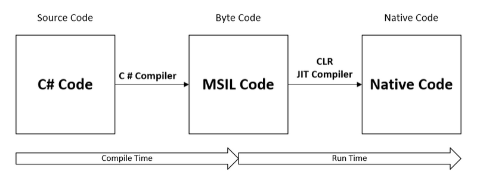
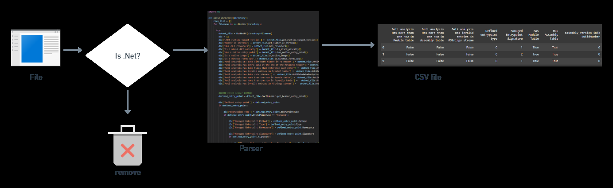
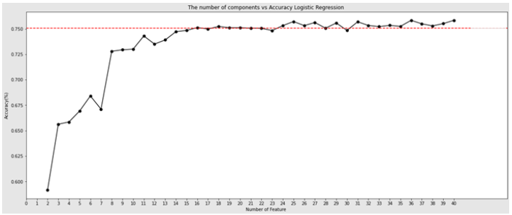
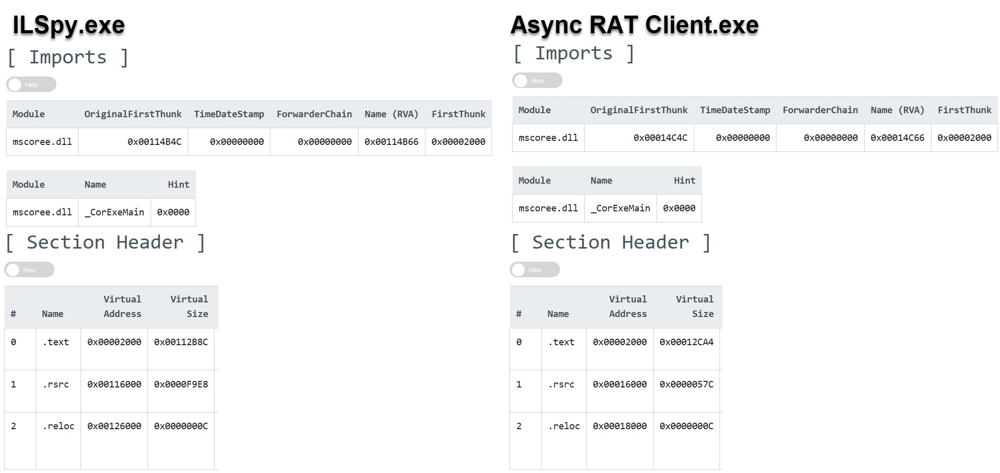
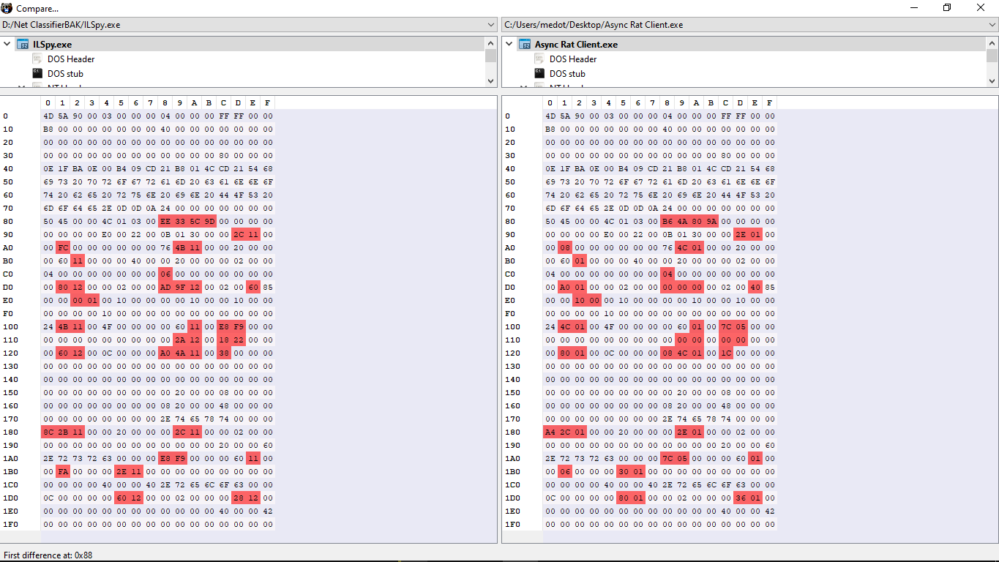

# Hassan et al. (2023) — Detecting Malicious .NET Files Using CLR Header Features and Machine Learning

> Faithful extraction for project use. Source PDF: `Reference/Detecting_Malicious_NET_Files_Using_CLR_Header_Fea.pdf`.
> Extracted 2026-11-27 with `pdftotext` (poppler 26.08) and `pdfimages`; figures re-rendered to PNG.
> The paper is licensed **CC BY 4.0**. The dataset repository has **no license file** (see §12).

## Metadata

| Field | Value |
|---|---|
| Authors | Mohammed Hassan, Mohamed Eid, Hossam Elnems, Eslam Ahmed, Ebraam Mesak, Paula Branco |
| Affiliation | Faculty of Engineering, University of Ottawa |
| Venue | 36th Canadian Conference on Artificial Intelligence (Canadian AI 2023), Montréal, QC, Canada, 5–9 June 2023 |
| Corresponding author | mhass167@uottawa.ca |
| License | CC BY 4.0 (paper) |
| Code + data | `https://github.com/MagicianMido32/Detecting-Malicious-.NET-Files-Using-CLR-Header-Features-and-Machine-Learning` |
| Keywords | .NET, CLR Header, Malware, Machine Learning, C# |

## TL;DR

The paper argues that the PE header is nearly identical across .NET binaries, so PE-header
features are weak for .NET malware detection. It extracts features from the **CLR header**
instead, builds a large .NET malware/benign dataset, and compares seven classical ML
models. Random Forest performs best with **F1 = 0.91135** on a **stratified random
5-fold CV**. The task is **generic malicious .NET vs benign .NET**, not AsyncRAT-specific.
Several features are name-based (assembly/module/type/method names), which the AsyncParser
project deliberately forbids.

## 1. Problem and motivation

- .NET made Windows application development easy; the same abstractions help malware authors.
- Between 2009 and 2015 there was a **1600% growth** in unique .NET malware (paper's citation [2]).
- CISA's 2021 top-10 list included three C# malware families: **Agent Tesla, LokiBot, NanoCore** [3].
- A .NET file is a normal PE for the Windows loader, but the code is **CIL/MSIL**, JIT-compiled by the CLR.
- .NET PE headers are nearly identical: they import only `mscoree.dll` and `_CorExeMain`.
  Therefore PE-header-only classification is not feasible for .NET files.
- The **CLR header** (undocumented by Microsoft) carries the metadata the CLR needs.
  The paper claims to be the first to use CLR-header features for ML-based .NET malware detection.

## 2. Background: .NET compilation



**Figure 1.** `C# Code` → `MSIL Code` via the C# compiler (compile time) → `Native Code`
via the CLR JIT compiler (run time).

The paper contrasts this with native PE files: a .NET binary contains CIL, not x86
assembly. The PE header exists for loader compatibility; the CLR header is the relevant
structure for the runtime.

## 3. Dataset

### 3.1 Malicious .NET files

- **216,006** malicious .NET files.
- Collected with custom scrapers from: Any.Run, MalwareBazaar, VirusShare, theZoo,
  VX Underground, Twitter, GitHub, and other sources.
- A filter tool removed non-.NET files.

### 3.2 Benign .NET files

- **14,194** benign .NET files.
- Sources:
  - 7,865 SourceForge
  - 3,603 CNET
  - 151 Softonic
  - 185 Windows 10 executables
  - 170 Windows Server 2019 executables
  - 400 PortableApps.com
  - 1,820 programs installed on the authors' machines
- All benign files were scanned with **Windows Defender, up to date on 18 February 2023**;
  none was detected as malicious or suspicious.

### 3.3 Parser and feature extraction

- Parser: Palo Alto's open-source Python library **`dotnetfile`** [20].
- It extracts CLR header information, metadata, and strings.
- Initial table: **66 features + target**, **222,204 records**.
- **14 constant features dropped** → **52 features kept**.
- 18 features are lists (imports, functions, namespaces, etc.) with very high cardinality.
  They are kept because they carry behaviour information (e.g., unmanaged functions can
  indicate process hollowing / RunPE [21]).



**Figure 4.** File → `Is .NET?` → `dotnetfile` parser → CSV. Non-.NET files are removed.

## 4. Features (Table 1 of the paper)

| Feature type | Count | Feature names |
|---|---:|---|
| Boolean | 22 | Has .NET resources; Is a mixed .NET assembly; Has a native entry point; Is a native image; Is a Windows Forms app; Anti analysis: .NET data directory hidden in PE header; Anti analysis: has extra data at the end of the metadata header; Anti analysis: has fake types that reference each other; Anti analysis: has invalid entries in TypeRef table; Anti analysis: has fake data streams; Anti analysis: has more than one row in Module table; Anti analysis: has more than one row in Assembly table; Anti analysis: has invalid entries in Strings stream; Has ModuleRef; Has ImplMap; Has TypeRef; Has MethodDef; Has MemberRef; Has Event; Has ManifestResource; Has Resources; Managed entrypoint signature has `this` pointer |
| Numeric | 9 | Number of streams; Len Strings stream strings; Len US stream strings; `assembly_version_info` BuildNumber; `assembly_version_info` MajorVersion; `assembly_version_info` MinorVersion; `assembly_version_info` RevisionNumber; Len possible method entry points; Len Resources |
| Low cardinality categorical | 3 | .NET runtime target version; Managed entrypoint signature Parameter; Managed entrypoint signature Return value |
| High cardinality (text) | 5 | Managed entrypoint Method; Managed defined entrypoint type; Managed entrypoint Namespace; Module name; Assembly Name |
| High cardinality (list text) | 13 | Stream names; All references; Existent metadata tables; Available tables; Assembly names; Referenced Types Names; TypeDef Names; Method names; `memberref_names`; Resource names; Unmanaged module names; Unmanaged functions; Event names |
| **Total** | **52** | |

Low cardinality = fewer than 100 distinct values.
"Text" = one string per sample; "list text" = a variable-length list of strings per sample.

### 4.1 Feature leakage warning for AsyncParser

The following are **sample-controlled names** and are forbidden as AsyncParser features
(obfuscators randomize them):

- Module name, Assembly Name
- Managed defined entrypoint type, Managed entrypoint Namespace, Managed entrypoint Method
- TypeDef Names, Method names, `memberref_names`, Event names, Resource names
- Referenced Types Names, Unmanaged module names, Unmanaged functions
- "All references" (their string encoding)

The non-name subset (22 booleans + 9 numerics + 3 low-cardinality + table-presence
information) is usable as a **comparison baseline**, not as the main feature set.

## 5. Encoding and feature selection

### 5.1 Encoding

- Low-cardinality categoricals (3): **label encoder** (no extra columns).
- High-cardinality text and list-text features (18): **hash encoder** from
  `category_encoders` [22], fitted on train and then applied to test.
- Result: **41 features** = 3 low-cardinality + 9 numeric + 22 boolean + 7 hash-encoded.
- The paper explicitly calls hash encoding a limitation: collisions and information loss.

### 5.2 Feature selection

- Method: **forward selection over logistic regression**.
- Split for selection: **stratified shuffled train/test split**.
- **Random oversampling on the training set** was used only during feature selection,
  so that the selected features would not be biased toward one class.
- Best result at **40 features** (logistic regression):

| Metric | Value |
|---|---:|
| Accuracy | 0.75906 |
| Precision | 0.72982 |
| Recall | 0.78929 |
| F1 | 0.75839 |

- Alternative: **Lasso regression** selected **11 features**; logistic regression on them:

| Metric | Value |
|---|---:|
| Accuracy | 0.72839 |
| Precision | 0.68750 |
| Recall | 0.79395 |
| F1 | 0.73690 |

- The 11-feature model was worse on F1 and precision. The paper concluded feature
  selection did not significantly improve the models, so the final experiments used
  **all features** and **no oversampling**.



**Figure 5.** Logistic-regression accuracy vs number of selected features (1–40).
Accuracy rises steeply to about 0.73 by 7–8 features, plateaus near 0.75 after about 15,
and reaches 0.759 at 40 features (red dashed line = 0.75).

## 6. Experimental setup

- Metrics: **accuracy, precision, recall, F1**; F1 is the primary metric.
- Validation: **stratified 5-fold cross-validation**; reported values are fold averages.
- Models (default parameters, no tuning):
  Decision Tree, Logistic Regression, MLP, Naïve Bayes, Random Forest, SVM, XGBoost.
- No oversampling in the final training runs.
- All original features used.

## 7. Results (Table 2 of the paper)

| Model | Accuracy | Precision | Recall | F1-score |
|---|---:|---:|---:|---:|
| **Random Forest** | **0.91634** | **0.92557** | 0.89756 | **0.91135** |
| XGBoost | 0.90909 | 0.92131 | 0.88591 | 0.90326 |
| MLP | 0.87005 | 0.85011 | 0.88475 | 0.86708 |
| Decision Tree | 0.85722 | 0.85765 | 0.84168 | 0.84959 |
| Logistic Regression | 0.77164 | 0.77214 | 0.77136 | 0.77139 |
| Naïve Bayes | 0.66760 | 0.60202 | **0.90338** | 0.72253 |
| SVM | 0.60904 | 0.55367 | **0.94878** | 0.69927 |

- Random Forest is best overall; XGBoost is second.
- SVM and Naïve Bayes achieve high recall at very low precision.
- Ensemble models dominate; the MLP struggles, possibly because of feature dimensionality.

## 8. Strengths and limitations (paper's own)

**Strengths**

- Novel CLR-header feature extraction as an alternative to PE-header features.
- First public .NET malware/benign dataset (paper's claim).
- Seven ML models compared.
- Scrapers released for benign and malicious .NET executables.

**Limitations**

- **Hash encoder** causes collisions and information loss.
- **Heavy class imbalance**: malicious:benign ≈ **15:1**.
- More data could enable deep learning.
- More models and extensive hyperparameter tuning left for future work.

## 9. Conclusion

The paper shows that CLR-header information is useful for .NET malware detection,
reaching **92% accuracy / 0.911 F1** with Random Forest on their dataset. Future work
suggested: better high-dimensional encoding (word embeddings + stacking), handling the
imbalance, and more data/models.

## 10. Figures (all extracted from the PDF)

### Figure 2 — PE header comparison (ILSpy vs AsyncRAT Client)



- Both binaries import **only** `mscoree.dll! _CorExeMain`.
- Section layout is the same: `.text`, `.rsrc`, `.reloc`.
- Differences are mainly virtual sizes, e.g. `.text` `0x00112B8C` (ILSpy) vs `0x0012CA4`
  (AsyncRAT), and `.rsrc` `0x0000F9E8` vs `0x0000057C`.
- The figure is used to argue that PE-header-only detection is not feasible for .NET.

### Figure 3 — Binary-level PE header comparison (PE Bear)



- Left: `ILSpy.exe`; right: `Async Rat Client.exe`.
- PE Bear reports the **first difference at `0x83`**.
- Highlighted bytes show that headers are nearly identical; differences are small
  offset/size fields, not semantic imports.

## 11. Repository contents and independent verification

The paper links a GitHub repository. I inspected it read-only on 2026-11-27:

| Item | Finding |
|---|---|
| Repository size | ~381 MB |
| Top-level dirs | `Benign/`, `Malicious/`, `EXE to CSV Parser/`, `Malicious_DotNet_Scraper/`, `README.md` |
| Benign corpus | `Benign/Benign exe/` contains **757 `.exe` files**, ~199.9 MB total |
| Paper claim | 14,194 benign files; the repo is a **subset** |
| License file | **None** in the repo (paper itself is CC BY 4.0) |
| Parser code | `EXE to CSV Parser/` (`parse_mal.py`, `combine all.ipynb`, helpers) |
| My sampling | 10 random benign EXEs: **10/10 had a CLR header**; sizes 4 KB–2.2 MB |
| Duplicates | yes, e.g. `7.exe` and `593.exe` have the same SHA-256 |

**Implication for AsyncParser:** the 757 benign EXEs are a useful supplementary
`clrheader2023` source. They are small (mostly 4 KB–2 MB) compared with our AsyncRAT
median (~553 KB), 2022-era, and from one publication. They supplement, not replace,
Chocolatey/GitHub app EXEs. Because the repo has no license, keep them local, cite the
paper, and do not redistribute them.

## 12. Relevance to AsyncParser (project-specific judgement)

### Use

1. **Related work and baseline.** This is the closest published work: ML on .NET files
   with CLR-header features. Our differentiators: AsyncRAT-client scope, capability
   features from external references, cluster-based splits, and no name-based features.
2. **Benign EXE source `clrheader2023`.** 757 raw .NET EXEs, deduplicated and CLR-filtered,
   recorded with provenance and citation. Research use only.
3. **External benign holdout.** Keep these 757 out of train/val/test and measure Stage 1
   false positives on them as a source-shift check.
4. **Comparison baseline (stretch).** Implement the **non-name subset** of their 52
   features (22 booleans + 9 numerics + 3 low-cardinality + table-presence signals) and
   train the same model on the same split. Report side-by-side. Tag it
   "CLR-header baseline (Hassan et al.)".

### Do not use

- **Name-based features** (Module/Assembly/TypeDef/Method/MemberRef/Event/Resource names,
  namespaces, unmanaged function names). They violate the project's capability-only rule
  and are obfuscation-fragile.
- **Random stratified split** for our evaluation. It can leak near-duplicate builds across
  folds; our cluster split exists specifically to prevent that. Their 92% is therefore
  not directly comparable to a cluster-split result.
- **Hash encoding** as the primary encoder. Their own limitation section admits collisions
  and information loss; our binary presence vocabulary avoids this.
- **Their malicious folder** for training: generic .NET malware without RAT family labels,
  out of scope for AsyncRAT detection.

### Caveats for citation

- Different task: generic .NET malware vs benign, not AsyncRAT client vs benign.
- Different split: random stratified 5-fold CV, not cluster/date split.
- Different feature rules: includes sample-controlled names.
- Different imbalance: ~15:1 malicious:benign.
- Their reported F1 0.911 should be presented as context, not as a target to beat.

## 13. Citation

```bibtex
@inproceedings{hassan2023clr,
  title     = {Detecting Malicious .NET Files Using CLR Header Features and Machine Learning},
  author    = {Hassan, Mohammed and Eid, Mohamed and Elnems, Hossam and Ahmed, Eslam and Mesak, Ebraam and Branco, Paula},
  booktitle = {Proceedings of the 36th Canadian Conference on Artificial Intelligence (Canadian AI 2023)},
  address   = {Montr{\'e}al, QC, Canada},
  year      = {2023},
  month     = jun
}
```

## 14. References (as printed in the paper)

1. Lifecycle FAQ - .NET Framework | Microsoft Learn. https://learn.microsoft.com/en-US/lifecycle/faq/dotnet-framework. Accessed 2022-12-20.
2. The rise of .NET and powershell malware | Securelist. https://securelist.com/the-rise-of-net-and-powershell-malware/72417/. Accessed 2022-12-21.
3. 2021 Top Malware Strains | CISA. https://www.cisa.gov/uscert/ncas/alerts/aa22-216a. Accessed 2022-12-21.
4. What is managed code? | Microsoft Learn. https://learn.microsoft.com/en-us/dotnet/standard/managed-code. Accessed 2022-12-21.
5. Automatic Memory Management | Microsoft Learn. https://learn.microsoft.com/en-us/dotnet/standard/automatic-memory-management. Accessed 2022-12-21.
6. PE Format - Win32 apps | Microsoft Learn. https://learn.microsoft.com/en-us/windows/win32/debug/pe-format. Accessed 2022-12-21.
7. Anatomy of a .NET Assembly – PE Headers. https://www.red-gate.com/simple-talk/blogs/anatomy-of-a-net-assembly-pe-headers/. Accessed 2023-02-19.
8. ILSpy - Microsoft Store Apps. https://apps.microsoft.com/store/detail/ilspy/9MXFBKFVSQ13. Accessed 2022-12-21.
9. AsyncRAT (Malware Family), Malpedia. https://malpedia.caad.fkie.fraunhofer.de/details/win.asyncrat. Accessed 2022-12-21.
10. PeNet Web. https://penet.azureedge.net/. Accessed 2022-12-21.
11. hasherezade's 1001 nights (PE Bear). https://github.com/hasherezade/pe-bear. Accessed 2023-02-19.
12. The .NET File Format. https://www.ntcore.com/files/dotnetformat.htm. Accessed 2022-12-21.
13. S. Choi, J. Bae, C. Lee, Y. Kim, and J. Kim. "Attention-based automated feature extraction for malware analysis". Sensors 20.10 (2020), p. 2893.
14. N. Visweswaran, M. Jeevanantham, C. T. Kani, P. Deepalakshmi, and S. Sathiyandrakumar. "Automated PE32 Threat Classification using Import Table and Deep Neural Networks". 2019 IEEE INCCES, pp. 1–5.
15. H. Shukla, S. Patil, D. Solanki, L. Singh, M. Swarnkar, and H. K. Thakkar. "On the design of supervised binary classifiers for malware detection using portable executable files". 2019 IEEE IACC, pp. 141–146.
16. T. Leemreize. "Analyzing fileless malware for the .NET Framework through CLR profiling". MA thesis, University of Twente, 2021.
17. Microsoft. Antimalware Scan Interface (AMSI). Archived docs. Accessed 2023-02-19.
18. Bring Your Own Interpreter (BYOI). https://synzack.github.io/Bring-Your-Own-Interpreter/. Accessed 2023-02-19.
19. Malware Payloads & Beacons: Types of Malicious Payloads. Illumio blog. Accessed 2023-02-19.
20. dotnetfile Open Source Python Library: Parsing .NET PE Files Has Never Been Easier. Palo Alto Unit 42. Accessed 2022-12-21.
21. Process Injection: Process Hollowing (T1055.012). MITRE ATT&CK. Accessed 2023-02-19.
22. Category Encoders — Category Encoders 2.5.1.post0 documentation. https://contrib.scikit-learn.org/category_encoders/. Accessed 2022-12-21.

## 15. Extraction provenance

- Text: `pdftotext -layout` (poppler 26.08).
- Figures: `pdfimages -png`; images embedded in this directory.
- The extraction is verbatim in substance; wording is condensed where the paper repeats
  itself. Numbers and table contents are copied exactly.
- The PDF is stored in `Reference/` (gitignored). This MD and its figures are under `Docs/`.
